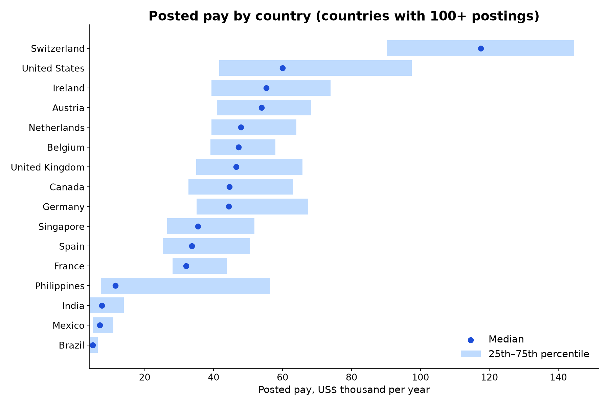
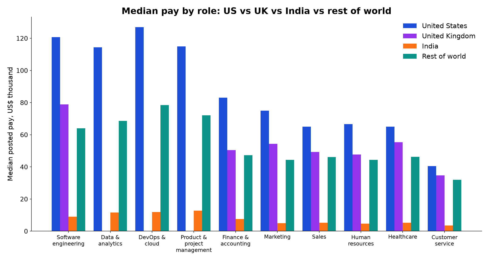
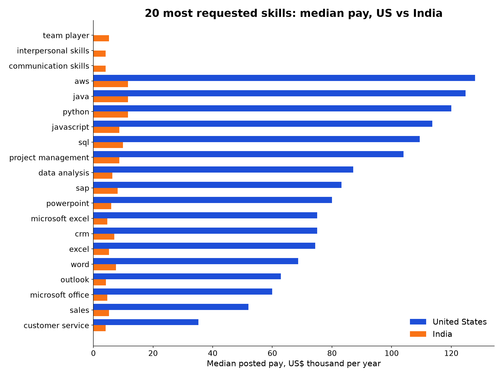

# Global Salary Data by Skill & Role (620k jobs): findings, method and data card

> Global salary data by skill and role: 620,752 job postings in 55 countries with pay in US$ per year, US vs UK vs India vs rest of world, Jan 2024 to Jun 2026.

*Fliar Research · released October 2026 · licence CC BY-NC 4.0*

**How this dataset was acquired.** Every row comes from the [Radar API](https://github.com/fliarbi/radar-api-mcp), Fliar's company-data API and MCP server. Radar reads
public job postings from job boards and company career pages in many countries every day and parses each one into structured fields:
title, employer, location, category, skills and pay. This release keeps the postings that state pay, published between January 2024 and
June 2026, removes re-posts, annualises every figure and converts it to **US dollars per year with one stated exchange-rate table**, so
skills, roles and countries can be compared on one scale. It holds no job descriptions, application links or recruiter names. Salary
statistics for any title, city, currency and skill set, refreshed daily, are served by `POST /v1/jobs/salary-benchmark`
([reference](https://github.com/fliarbi/radar-api-mcp/blob/main/docs/reference/salary_benchmark.md)) or the `salary_benchmark` MCP tool.

> **This file is a 16% sample: 100,060 of 620,752 job postings with pay.** It keeps every record for a fixed subset of companies.
> The subset is chosen by a hash, so it stays the same from one release to the next. The findings and tables below were computed
> on the **full** data. For the rest, the withheld fields and monthly updates, [get a Radar API key](https://fliarbi.com/radar-api/developer) ([docs](https://github.com/fliarbi/radar-api-mcp)).
> Each row's `fliar_profile_url` opens the company's full profile on Fliar.

## Full dataset on request

This release publishes about **100,000 postings** (a fixed set of whole companies). The **complete set of 620,752 postings** in 55 countries,
with the same columns, is available **on request** for research, journalism and other fair use.

- **Email** [b2b@fliarbi.com](mailto:b2b@fliarbi.com) with your name, organisation and a short description of how you will use the data, or
- use the **[Fliar contact page](https://fliarbi.com/contact)**.

## Key findings

1. **620,752 job postings with stated pay from 137,004 employers in 55 countries**, January 2024 to June 2026, every figure annualised and converted to US$. 56% are in the United States; 22 countries have at least 30 postings and 14 have at least 400.
2. **Country medians span 24×** among the 14 countries with 400+ postings: Switzerland $117,470, United States $60,000, Ireland $55,319, Austria $53,933 at the top; India $7,558, Brazil $4,896 at the bottom.
3. **Software engineering pays a median $120,805 in the US**, $78,947 in the UK and $9,012 in India at market exchange rates, a 13× US–India gap.
4. **109,469 postings carry skill tags.** Among skills with 200+ US postings the best paid are ai ($134,000), c++ ($131,000), aws ($128,000), kubernetes ($125,750).
5. **In India the best-paid tagged skills** (200+ postings) are ca ($31,977), llm ($31,977), microservices architecture ($31,395), bfsi sales ($29,070), against a national median of $7,558.
6. **The UK sample is small** (2,129 postings, median $46,581): few UK postings in the collection state pay, so UK figures carry wide uncertainty. 1,553 postings with absurd or unconvertible pay were dropped before any statistic was computed.

### Salary percentiles by country (US$ per year)

Countries with at least 10 postings. "Posted in" is the most common posting currency (Gulf and some Asian listings were advertised in Indian rupees by an Indian board). Countries under 100 postings are indicative only.

| Country              | Postings   | Employers   | Posted in   | Median, local   | 10th pct   | 25th pct   | Median   | 75th pct   | 90th pct   | With skills   |
|:---------------------|:-----------|:------------|:------------|:----------------|:-----------|:-----------|:---------|:-----------|:-----------|:--------------|
| United States        | 350,328    | 73,471      | USD         | 60,000          | $33,280    | $41,600    | $60,000  | $97,500    | $140,000   | 15.5%         |
| Canada               | 112,874    | 26,849      | CAD         | 62,400          | $26,743    | $32,686    | $44,571  | $63,143    | $85,714    | 0.0%          |
| France               | 66,792     | 12,118      | EUR         | 28,500          | $26,292    | $28,045    | $32,022  | $43,820    | $70,112    | 0.0%          |
| India                | 49,355     | 10,015      | INR         | 650,000         | $2,616     | $4,070     | $7,558   | $13,953    | $28,488    | 98.9%         |
| Germany              | 19,332     | 5,386       | EUR         | 39,520          | $31,551    | $35,056    | $44,404  | $67,416    | $116,854   | 0.0%          |
| Netherlands          | 6,784      | 2,262       | EUR         | 42,600          | $34,495    | $39,371    | $47,865  | $64,045    | $80,899    | 0.0%          |
| Singapore            | 6,080      | 2,165       | SGD         | 46,440          | $20,611    | $26,565    | $35,450  | $51,870    | $77,863    | 99.8%         |
| United Kingdom       | 2,129      | 1,132       | GBP         | 35,402          | $31,776    | $35,004    | $46,581  | $65,789    | $88,816    | 0.0%          |
| Austria              | 2,110      | 1,060       | EUR         | 48,000          | $32,252    | $40,969    | $53,933  | $68,364    | $84,270    | 0.0%          |
| Switzerland          | 1,597      | 483         | CHF         | 97,500          | $70,357    | $90,361    | $117,470 | $144,578   | $168,675   | 0.0%          |
| Spain                | 891        | 487         | EUR         | 30,000          | $20,225    | $25,281    | $33,708  | $50,562    | $73,146    | 0.0%          |
| Belgium              | 542        | 245         | EUR         | 42,000          | $33,696    | $39,101    | $47,191  | $57,951    | $73,034    | 0.0%          |
| Brazil               | 449        | 335         | BRL         | 27,420          | $3,320     | $4,050     | $4,896   | $6,429     | $8,572     | 0.0%          |
| Ireland              | 439        | 276         | EUR         | 49,234          | $33,389    | $39,326    | $55,319  | $73,910    | $101,124   | 0.0%          |
| Mexico               | 278        | 204         | MXN         | 135,537         | $3,665     | $5,005     | $7,023   | $10,881    | $18,653    | 0.0%          |
| Philippines          | 159        | 72          | PHP         | 660,000         | $5,092     | $7,304     | $11,478  | $56,348    | $63,110    | 46.5%         |
| Australia            | 86         | 70          | AUD         | 84,568          | $43,534    | $47,469    | $54,560  | $69,836    | $78,297    | 0.0%          |
| Malaysia             | 69         | 32          | MYR         | 150,000         | $9,655     | $13,103    | $24,419  | $38,663    | $56,600    | 100.0%        |
| New Zealand          | 45         | 34          | NZD         | 112,099         | $30,716    | $40,559    | $65,174  | $90,698    | $101,233   | 0.0%          |
| Colombia             | 35         | 32          | COP         | 22,800,000      | $3,805     | $4,166     | $5,561   | $9,132     | $19,171    | 0.0%          |
| Czechia              | 35         | 30          | CZK         | 1,188,000       | $17,333    | $41,333    | $52,800  | $76,000    | $83,200    | 0.0%          |
| Greece               | 30         | 18          | EUR         | 19,750          | $16,652    | $20,225    | $22,191  | $27,107    | $61,933    | 0.0%          |
| South Africa         | 29         | 24          | ZAR         | 294,000         | $5,267     | $8,333     | $16,333  | $27,778    | $34,889    | 0.0%          |
| United Arab Emirates | 27         | 17          | INR         | 1,050,000       | $10,953    | $12,209    | $16,860  | $22,093    | $34,884    | 100.0%        |
| Qatar                | 23         | 10          | INR         | 1,525,000       | $11,802    | $15,698    | $23,256  | $26,744    | $66,512    | 82.6%         |
| Indonesia            | 21         | 12          | INR         | 2,000,000       | $4,024     | $4,098     | $5,488   | $9,884     | $39,000    | 61.9%         |
| Portugal             | 19         | 15          | EUR         | 15,870          | $14,090    | $16,476    | $17,832  | $29,213    | $62,921    | 0.0%          |
| Italy                | 18         | 17          | EUR         | 22,880          | $21,615    | $23,764    | $25,708  | $33,281    | $38,865    | 0.0%          |
| Finland              | 17         | 15          | EUR         | 34,319          | $29,307    | $30,476    | $38,561  | $71,591    | $101,471   | 0.0%          |
| Namibia              | 17         | 12          | INR         | 1,625,000       | $6,570     | $6,977     | $18,895  | $31,977    | $79,070    | 100.0%        |
| Puerto Rico          | 16         | 12          | USD         | 50,000          | $36,125    | $49,125    | $50,000  | $77,716    | $128,005   | 0.0%          |
| Chile                | 15         | 11          | CLP         | 7,800,000       | $6,043     | $6,998     | $8,211   | $10,800    | $13,122    | 0.0%          |
| Japan                | 15         | 7           | INR         | 2,175,000       | $16,047    | $19,186    | $20,800  | $26,125    | $42,450    | 66.7%         |
| Uruguay              | 10         | 8           | UYU         | 627,360         | $5,816     | $7,560     | $15,684  | $16,543    | $17,046    | 0.0%          |

### Role family: United States vs United Kingdom vs India vs rest of world (median US$)

Median annual pay in US$; a median is shown only where the region has 20+ postings for the role. Sorted by the US median.

| Role family                  | United States median   | United States postings   | United Kingdom median   | United Kingdom postings   | India median   | India postings   | Rest of world median   | Rest of world postings   |
|:-----------------------------|:-----------------------|:-------------------------|:------------------------|:--------------------------|:---------------|:-----------------|:-----------------------|:-------------------------|
| DevOps & cloud               | $126,950               | 656                      |                         | 2                         | $11,919        | 780              | $78,503                | 428                      |
| Software engineering         | $120,805               | 6,872                    | $78,947                 | 76                        | $9,012         | 12,094           | $63,987                | 7,282                    |
| Product & project management | $115,000               | 4,668                    |                         | 16                        | $12,791        | 864              | $72,057                | 2,109                    |
| Data & analytics             | $114,400               | 2,609                    |                         | 8                         | $11,628        | 2,205            | $68,571                | 1,194                    |
| Design                       | $92,500                | 3,447                    |                         | 7                         | $8,430         | 1,909            | $56,429                | 2,169                    |
| Science & research           | $83,200                | 2,127                    | $44,454                 | 21                        | $5,814         | 228              | $50,663                | 938                      |
| Finance & accounting         | $83,000                | 18,783                   | $50,493                 | 138                       | $7,558         | 2,886            | $47,191                | 12,091                   |
| Legal                        | $81,289                | 4,723                    | $58,096                 | 54                        | $6,395         | 406              | $51,005                | 1,666                    |
| IT support                   | $75,000                | 1,703                    |                         | 6                         | $5,523         | 437              | $47,191                | 664                      |
| Operations                   | $75,000                | 19,829                   |                         | 19                        | $6,395         | 647              | $44,571                | 2,363                    |
| Marketing                    | $75,000                | 8,593                    | $54,336                 | 26                        | $4,942         | 2,254            | $44,382                | 5,896                    |
| Construction & trades        | $72,800                | 9,622                    | $49,222                 | 48                        | $7,267         | 473              | $40,857                | 6,029                    |
| Human resources              | $66,560                | 5,365                    | $47,697                 | 32                        | $4,651         | 1,676            | $44,404                | 3,013                    |
| Healthcare                   | $65,000                | 56,961                   | $55,362                 | 113                       | $5,233         | 1,009            | $46,260                | 13,733                   |
| Sales                        | $65,000                | 28,411                   | $49,342                 | 168                       | $5,233         | 7,109            | $46,057                | 9,183                    |
| Other                        | $58,700                | 68,163                   | $46,053                 | 568                       | $8,430         | 7,140            | $39,613                | 61,428                   |
| Manufacturing & maintenance  | $55,000                | 25,796                   | $52,632                 | 293                       | $6,686         | 1,793            | $39,326                | 23,951                   |
| Education                    | $50,000                | 16,056                   | $46,053                 | 84                        | $5,814         | 876              | $39,888                | 9,218                    |
| Administration               | $47,840                | 13,371                   | $34,868                 | 122                       | $5,814         | 1,021            | $37,143                | 14,358                   |
| Logistics & delivery         | $47,840                | 17,874                   | $36,717                 | 118                       | $7,558         | 703              | $32,719                | 17,300                   |
| Security                     | $46,800                | 2,597                    |                         | 9                         | $9,884         | 202              | $34,067                | 816                      |
| Customer service             | $40,500                | 10,241                   | $34,758                 | 81                        | $3,564         | 2,043            | $31,943                | 6,003                    |
| Retail & hospitality         | $36,816                | 21,861                   | $33,965                 | 120                       | $5,523         | 600              | $31,943                | 17,108                   |

### Seniority: United States vs United Kingdom vs India vs rest of world (median US$)

Seniority from the posting or title, else from years of experience asked.

| Seniority   | United States median   | United States postings   | United Kingdom median   | United Kingdom postings   | India median   | India postings   | Rest of world median   | Rest of world postings   |
|:------------|:-----------------------|:-------------------------|:------------------------|:--------------------------|:---------------|:-----------------|:-----------------------|:-------------------------|
| intern      | $42,640                | 3,580                    | $36,184                 | 41                        | $1,744         | 2,134            | $40,449                | 1,362                    |
| entry       | $41,600                | 37,496                   | $46,362                 | 35                        | $4,070         | 8,421            | $35,657                | 5,128                    |
| mid         | $70,000                | 17,227                   |                         | 0                         | $7,558         | 13,823           | $35,725                | 2,366                    |
| senior      | $100,000               | 19,765                   | $66,118                 | 110                       | $11,047        | 8,130            | $66,071                | 6,088                    |
| lead        | $86,320                | 10,936                   | $55,921                 | 88                        | $13,953        | 4,377            | $70,571                | 3,150                    |
| manager     | $83,200                | 47,425                   | $55,973                 | 312                       | $8,721         | 7,411            | $54,971                | 19,569                   |
| director    | $130,000               | 12,432                   | $98,684                 | 49                        | $29,070        | 1,282            | $86,171                | 2,696                    |
| executive   | $159,000               | 3,131                    |                         | 12                        | $34,884        | 535              | $89,143                | 942                      |

### Industry / occupation group: US vs UK vs India vs rest of world (median US$)

| Industry group                    | United States median   | United States postings   | United Kingdom median   | United Kingdom postings   | India median   | India postings   | Rest of world median   | Rest of world postings   |
|:----------------------------------|:-----------------------|:-------------------------|:------------------------|:--------------------------|:---------------|:-----------------|:-----------------------|:-------------------------|
| Software & IT                     | $117,500               | 8,472                    | $77,303                 | 88                        | $8,140         | 10,511           | $62,400                | 8,327                    |
| Legal & Compliance                | $100,000               | 1,970                    | $58,298                 | 47                        | $6,977         | 80               | $50,225                | 1,162                    |
| Operations & Consulting           | $100,000               | 24,003                   | $55,921                 | 20                        | $8,721         | 420              | $60,385                | 1,428                    |
| Banking, Finance & Accounts       | $82,000                | 16,471                   | $48,700                 | 118                       | $6,395         | 2,197            | $45,822                | 10,112                   |
| Science & Research                | $77,522                | 1,287                    |                         | 0                         |                | 0                |                        | 0                        |
| Engineering & Manufacturing       | $75,000                | 14,810                   | $53,136                 | 296                       | $6,977         | 1,746            | $42,067                | 19,431                   |
| Human Resources                   | $69,846                | 977                      | $47,368                 | 27                        | $4,942         | 1,002            | $44,888                | 2,112                    |
| Marketing, Media & Communications | $67,500                | 3,671                    | $55,973                 | 28                        | $5,814         | 816              | $42,697                | 5,099                    |
| Healthcare & Pharma               | $66,123                | 28,742                   | $52,632                 | 115                       | $4,651         | 704              | $42,416                | 9,449                    |
| Construction & Real Estate        | $62,400                | 3,294                    |                         | 7                         | $8,140         | 520              | $33,888                | 4,819                    |
| Education & Training              | $56,116                | 8,151                    | $50,242                 | 55                        | $4,651         | 517              | $45,443                | 6,780                    |
| Community & Social Service        | $54,080                | 2,882                    |                         | 0                         |                | 0                |                        | 0                        |
| Sales & Business Development      | $52,000                | 15,572                   | $46,053                 | 119                       | $5,233         | 3,426            | $50,000                | 5,676                    |
| Logistics & Supply Chain          | $46,985                | 12,056                   | $36,184                 | 142                       | $6,395         | 410              | $33,708                | 18,204                   |
| Facilities & Maintenance          | $45,760                | 5,536                    |                         | 0                         |                | 0                |                        | 0                        |
| Security & Protective Services    | $45,760                | 846                      |                         | 0                         |                | 0                |                        | 0                        |
| Admin & Office Support            | $44,720                | 9,028                    | $34,402                 | 70                        | $3,924         | 110              | $34,914                | 9,866                    |
| Customer Service & BPO            | $44,720                | 3,698                    | $35,298                 | 84                        | $3,779         | 1,716            | $32,360                | 6,024                    |
| Retail & E-commerce               | $39,520                | 2,598                    | $33,773                 | 43                        | $5,959         | 194              | $34,171                | 5,285                    |
| Personal Care & Services          | $39,520                | 2,985                    |                         | 0                         |                | 0                |                        | 0                        |
| Hospitality & Food                | $35,360                | 6,426                    | $34,347                 | 58                        | $4,651         | 194              | $30,476                | 9,459                    |
| Data & Analytics                  |                        | 0                        |                         | 0                         | $6,977         | 732              |                        | 2                        |
| Product, Design & UX              |                        | 0                        |                         | 0                         | $6,977         | 253              |                        | 0                        |

### Top 50 most requested skills with salary percentiles: US vs India vs rest of world

Skills as tagged in postings (lower-cased). Skill tags exist mainly on US, Indian and Singapore postings; UK postings in this collection carry no skill tags. A median is shown where the group has 20+ postings.

| #   | Skill                  | Postings   | Employers   | Global median   | US median   | US postings   | India median   | India postings   | Rest-of-world median   |
|:----|:-----------------------|:-----------|:------------|:----------------|:------------|:--------------|:---------------|:-----------------|:-----------------------|
| 1   | excel                  | 6,669      | 3,867       | $68,000         | $74,413     | 5,794         | $5,233         | 536              | $31,145                |
| 2   | python                 | 5,104      | 2,100       | $17,442         | $120,000    | 1,075         | $11,628        | 3,879            | $64,122                |
| 3   | microsoft office       | 4,943      | 3,029       | $49,920         | $60,000     | 3,404         | $4,651         | 146              | $29,313                |
| 4   | sql                    | 4,178      | 1,816       | $15,988         | $109,396    | 976           | $9,884         | 3,015            | $64,122                |
| 5   | sales                  | 4,055      | 2,021       | $6,977          | $52,000     | 129           | $5,233         | 3,377            | $32,977                |
| 6   | word                   | 2,789      | 1,831       | $67,600         | $68,640     | 2,733         | $7,558         | 55               |                        |
| 7   | java                   | 2,717      | 1,175       | $16,279         | $124,815    | 350           | $11,628        | 2,215            | $65,840                |
| 8   | project management     | 2,627      | 1,580       | $36,641         | $104,000    | 869           | $8,721         | 1,202            | $45,802                |
| 9   | customer service       | 2,561      | 1,199       | $19,237         | $35,256     | 220           | $4,070         | 1,171            | $28,397                |
| 10  | communication skills   | 2,540      | 1,418       | $6,395          |             | 0             | $4,070         | 1,650            | $33,435                |
| 11  | powerpoint             | 2,350      | 1,538       | $75,000         | $80,000     | 2,127         | $6,035         | 73               | $34,351                |
| 12  | javascript             | 2,275      | 1,125       | $11,047         | $113,650    | 206           | $8,721         | 1,950            | $65,038                |
| 13  | outlook                | 2,043      | 1,392       | $60,259         | $62,900     | 1,897         | $4,215         | 22               | $30,000                |
| 14  | data analysis          | 2,018      | 1,113       | $10,465         | $87,120     | 635           | $6,395         | 1,284            | $50,382                |
| 15  | crm                    | 1,943      | 1,408       | $55,000         | $75,000     | 1,341         | $6,977         | 452              | $34,351                |
| 16  | microsoft excel        | 1,817      | 1,126       | $34,809         | $75,000     | 550           | $4,651         | 118              | $29,771                |
| 17  | aws                    | 1,732      | 838         | $19,259         | $128,000    | 441           | $11,628        | 1,274            |                        |
| 18  | sap                    | 1,727      | 922         | $41,600         | $83,200     | 795           | $8,140         | 634              | $36,641                |
| 19  | interpersonal skills   | 1,696      | 948         | $27,939         |             | 0             | $4,070         | 414              | $33,435                |
| 20  | team player            | 1,484      | 809         | $29,771         |             | 0             | $5,233         | 31               | $29,771                |
| 21  | business development   | 1,474      | 938         | $8,140          | $115,800    | 91            | $5,814         | 1,050            | $45,802                |
| 22  | compliance             | 1,472      | 828         | $31,145         | $105,350    | 128           | $8,430         | 545              | $38,015                |
| 23  | inventory management   | 1,469      | 965         | $36,400         | $43,264     | 912           | $5,814         | 377              | $32,061                |
| 24  | salesforce             | 1,465      | 1,027       | $65,000         | $85,000     | 1,022         | $9,884         | 435              |                        |
| 25  | accounting             | 1,462      | 957         | $31,977         | $91,400     | 398           | $6,395         | 587              | $33,435                |
| 26  | troubleshooting        | 1,381      | 799         | $25,191         | $63,336     | 203           | $7,558         | 589              | $34,351                |
| 27  | electrical             | 1,380      | 933         | $50,000         | $62,400     | 804           | $6,395         | 52               | $35,725                |
| 28  | ms office              | 1,345      | 884         | $40,290         | $70,000     | 709           | $5,794         | 392              | $30,916                |
| 29  | lead generation        | 1,345      | 877         | $4,651          | $70,000     | 39            | $4,512         | 1,235            | $41,221                |
| 30  | microsoft office suite | 1,317      | 983         | $70,000         | $70,000     | 1,274         | $8,230         | 42               |                        |
| 31  | data entry             | 1,299      | 824         | $27,481         | $41,600     | 511           | $3,198         | 335              | $23,817                |
| 32  | autocad                | 1,253      | 727         | $34,809         | $89,440     | 463           | $5,814         | 514              | $36,641                |
| 33  | marketing              | 1,244      | 828         | $16,279         | $72,500     | 62            | $6,395         | 912              | $36,641                |
| 34  | inventory              | 1,184      | 588         | $27,481         | $47,944     | 77            | $5,814         | 62               | $27,481                |
| 35  | administration         | 1,182      | 552         | $31,145         |             | 15            | $6,395         | 117              | $32,061                |
| 36  | hvac                   | 1,146      | 782         | $60,000         | $62,400     | 1,030         | $6,977         | 81               | $41,221                |
| 37  | digital marketing      | 1,128      | 880         | $7,645          | $90,000     | 146           | $4,651         | 840              | $34,809                |
| 38  | azure                  | 1,123      | 646         | $20,930         | $125,000    | 259           | $11,192        | 788              | $68,702                |
| 39  | cpr                    | 1,122      | 699         | $45,760         | $45,760     | 1,119         |                | 3                |                        |
| 40  | negotiation            | 1,088      | 710         | $20,349         | $101,000    | 60            | $4,651         | 552              | $38,931                |
| 41  | agile                  | 1,054      | 618         | $15,698         | $115,000    | 256           | $9,012         | 669              | $65,038                |
| 42  | driver's license       | 1,053      | 716         | $45,760         | $45,760     | 1,053         |                | 0                |                        |
| 43  | microsoft word         | 1,010      | 655         | $37,440         | $65,000     | 487           | $3,701         | 20               | $25,649                |
| 44  | kubernetes             | 1,007      | 533         | $20,349         | $125,750    | 202           | $14,535        | 768              | $68,702                |
| 45  | docker                 | 1,005      | 529         | $18,605         | $124,800    | 160           | $13,953        | 790              | $68,702                |
| 46  | react.js               | 992        | 633         | $14,535         |             | 11            | $14,535        | 977              |                        |
| 47  | git                    | 957        | 478         | $10,465         | $120,000    | 132           | $8,430         | 795              | $68,702                |
| 48  | scheduling             | 945        | 655         | $36,641         | $65,000     | 323           | $5,523         | 127              | $33,435                |
| 49  | construction           | 940        | 576         | $41,221         | $100,000    | 182           | $7,849         | 56               | $38,931                |
| 50  | automation             | 917        | 528         | $12,209         | $120,000    | 267           | $8,430         | 643              |                        |

### Top 50 highest-paying skills in the United States (150+ postings, 20+ employers)

Ranked by median annual pay among postings that tag the skill (US$ at the stated FX rate).

| #   | Skill                  | Postings   | Employers   | 10th pct   | 25th pct   | Median   | 75th pct   | 90th pct   |
|:----|:-----------------------|:-----------|:------------|:-----------|:-----------|:---------|:-----------|:-----------|
| 1   | ai                     | 485        | 381         | $65,434    | $99,000    | $134,000 | $171,976   | $200,270   |
| 2   | machine learning       | 158        | 131         | $65,000    | $98,250    | $133,725 | $165,000   | $197,700   |
| 3   | saas                   | 156        | 132         | $69,250    | $97,900    | $133,100 | $166,675   | $200,000   |
| 4   | react                  | 158        | 130         | $84,529    | $104,738   | $132,800 | $162,850   | $187,830   |
| 5   | gcp                    | 175        | 138         | $85,720    | $112,700   | $131,600 | $162,472   | $190,816   |
| 6   | c++                    | 225        | 137         | $80,320    | $101,920   | $131,000 | $164,320   | $190,000   |
| 7   | aws                    | 441        | 278         | $80,000    | $101,700   | $128,000 | $160,000   | $186,100   |
| 8   | kubernetes             | 202        | 137         | $86,900    | $102,875   | $125,750 | $160,750   | $184,600   |
| 9   | azure                  | 259        | 198         | $80,000    | $100,000   | $125,000 | $160,000   | $185,000   |
| 10  | java                   | 350        | 208         | $80,001    | $100,000   | $124,815 | $157,750   | $180,000   |
| 11  | docker                 | 160        | 117         | $83,180    | $100,375   | $124,800 | $154,489   | $180,640   |
| 12  | engineering            | 154        | 119         | $63,664    | $85,488    | $120,000 | $156,000   | $164,700   |
| 13  | automation             | 267        | 226         | $69,800    | $93,150    | $120,000 | $155,185   | $181,836   |
| 14  | python                 | 1,075      | 593         | $71,437    | $93,600    | $120,000 | $150,000   | $176,460   |
| 15  | procurement            | 223        | 190         | $62,400    | $86,800    | $120,000 | $156,000   | $170,000   |
| 16  | analytics              | 258        | 211         | $65,910    | $89,084    | $118,900 | $146,725   | $180,000   |
| 17  | civil engineering      | 237        | 130         | $70,432    | $90,000    | $117,563 | $150,000   | $171,755   |
| 18  | electrical engineering | 240        | 167         | $75,000    | $91,963    | $117,300 | $143,122   | $166,400   |
| 19  | linux                  | 237        | 140         | $69,020    | $89,000    | $116,480 | $145,600   | $167,797   |
| 20  | supply chain           | 171        | 134         | $70,000    | $85,000    | $115,400 | $143,260   | $173,000   |
| 21  | risk management        | 199        | 176         | $63,891    | $89,000    | $115,000 | $150,000   | $175,000   |
| 22  | agile                  | 256        | 216         | $69,775    | $90,000    | $115,000 | $140,000   | $169,802   |
| 23  | mechanical engineering | 233        | 163         | $80,000    | $90,000    | $114,400 | $144,000   | $170,000   |
| 24  | javascript             | 206        | 135         | $63,700    | $86,978    | $113,650 | $140,000   | $175,000   |
| 25  | finance                | 154        | 133         | $54,080    | $70,000    | $111,160 | $150,000   | $185,880   |
| 26  | sql                    | 976        | 666         | $67,600    | $85,000    | $109,396 | $135,200   | $165,800   |
| 27  | ai tools               | 189        | 166         | $55,240    | $75,000    | $108,100 | $140,000   | $182,600   |
| 28  | financial modeling     | 318        | 257         | $71,000    | $87,100    | $105,710 | $150,000   | $177,235   |
| 29  | data analytics         | 174        | 150         | $50,625    | $76,399    | $104,780 | $144,325   | $180,000   |
| 30  | forecasting            | 318        | 283         | $62,470    | $82,250    | $104,000 | $142,975   | $176,015   |
| 31  | project management     | 869        | 644         | $60,000    | $79,000    | $104,000 | $135,000   | $162,360   |
| 32  | jira                   | 271        | 208         | $60,800    | $77,550    | $102,000 | $129,600   | $156,100   |
| 33  | bluebeam               | 181        | 121         | $62,400    | $79,040    | $100,000 | $120,000   | $153,000   |
| 34  | netsuite               | 216        | 180         | $57,000    | $75,000    | $100,000 | $136,025   | $160,000   |
| 35  | ms project             | 167        | 132         | $69,731    | $84,700    | $100,000 | $125,000   | $155,220   |
| 36  | financial analysis     | 183        | 148         | $60,000    | $75,000    | $100,000 | $128,300   | $157,608   |
| 37  | procore                | 186        | 121         | $62,400    | $80,000    | $100,000 | $125,000   | $146,700   |
| 38  | construction           | 182        | 137         | $41,600    | $60,080    | $100,000 | $135,375   | $160,900   |
| 39  | networking             | 162        | 140         | $52,000    | $65,146    | $99,920  | $135,200   | $179,900   |
| 40  | tableau                | 352        | 283         | $63,015    | $77,400    | $96,245  | $123,704   | $155,800   |
| 41  | budgeting              | 365        | 313         | $54,000    | $70,000    | $95,000  | $129,000   | $160,000   |
| 42  | power bi               | 486        | 394         | $61,950    | $75,000    | $95,000  | $120,000   | $150,000   |
| 43  | erp                    | 499        | 402         | $52,000    | $65,000    | $95,000  | $129,000   | $160,000   |
| 44  | gaap                   | 226        | 197         | $57,380    | $69,604    | $95,000  | $126,970   | $155,500   |
| 45  | financial reporting    | 222        | 190         | $55,000    | $73,879    | $95,000  | $124,100   | $161,454   |
| 46  | nursing                | 258        | 190         | $66,917    | $79,040    | $93,600  | $114,400   | $135,200   |
| 47  | oracle                 | 342        | 236         | $53,604    | $68,000    | $91,430  | $130,000   | $160,900   |
| 48  | accounting             | 398        | 316         | $45,604    | $60,320    | $91,400  | $129,500   | $164,300   |
| 49  | revit                  | 234        | 119         | $63,000    | $75,725    | $90,000  | $110,000   | $135,000   |
| 50  | autocad                | 463        | 267         | $55,060    | $70,000    | $89,440  | $112,500   | $140,000   |

### Top 50 highest-paying skills in India (100+ postings, 20+ employers)

Ranked by median annual pay among postings that tag the skill (US$ at the stated FX rate).

| #   | Skill                       | Postings   | Employers   | 10th pct   | 25th pct   | Median   | 75th pct   | 90th pct   | Median, ₹ lakh   |
|:----|:----------------------------|:-----------|:------------|:-----------|:-----------|:---------|:-----------|:-----------|:-----------------|
| 1   | sales head                  | 182        | 135         | $26,163    | $36,773    | $50,000  | $70,349    | $98,837    | 43.0             |
| 2   | technical architect         | 108        | 80          | $26,163    | $37,645    | $49,419  | $63,953    | $85,000    | 42.5             |
| 3   | distributed systems         | 143        | 102         | $9,012     | $21,512    | $41,279  | $69,767    | $92,442    | 35.5             |
| 4   | finance and accounts        | 159        | 122         | $20,349    | $24,419    | $34,884  | $47,965    | $70,233    | 30.0             |
| 5   | rag                         | 120        | 97          | $12,209    | $24,419    | $34,012  | $43,605    | $58,140    | 29.2             |
| 6   | backend architecture        | 134        | 109         | $16,279    | $23,256    | $33,140  | $44,477    | $71,802    | 28.5             |
| 7   | agentic ai                  | 122        | 105         | $8,430     | $23,401    | $32,849  | $46,512    | $66,279    | 28.2             |
| 8   | llm                         | 250        | 200         | $8,983     | $20,930    | $31,977  | $40,698    | $58,140    | 27.5             |
| 9   | ca                          | 317        | 215         | $16,860    | $22,093    | $31,977  | $44,767    | $70,698    | 27.5             |
| 10  | microservices architecture  | 247        | 187         | $10,233    | $20,349    | $31,395  | $40,698    | $55,233    | 27.0             |
| 11  | bfsi sales                  | 252        | 142         | $3,093     | $4,942     | $29,070  | $40,698    | $63,953    | 25.0             |
| 12  | investment banking          | 107        | 82          | $5,930     | $12,674    | $29,070  | $43,605    | $61,047    | 25.0             |
| 13  | sales planning              | 120        | 100         | $3,430     | $5,523     | $27,035  | $43,605    | $76,395    | 23.2             |
| 14  | generative ai               | 321        | 249         | $7,558     | $13,953    | $26,163  | $40,698    | $55,233    | 22.5             |
| 15  | financial planning          | 196        | 145         | $4,936     | $9,302     | $26,163  | $41,424    | $78,488    | 22.5             |
| 16  | data engineering            | 283        | 188         | $7,849     | $14,535    | $26,163  | $40,698    | $52,326    | 22.5             |
| 17  | full stack                  | 214        | 164         | $6,395     | $11,773    | $26,163  | $37,791    | $48,488    | 22.5             |
| 18  | langchain                   | 122        | 108         | $7,267     | $13,953    | $26,163  | $37,791    | $49,128    | 22.5             |
| 19  | product design              | 182        | 75          | $5,262     | $11,628    | $25,581  | $43,459    | $57,907    | 22.0             |
| 20  | corporate sales             | 176        | 132         | $4,651     | $11,047    | $25,000  | $36,773    | $53,779    | 21.5             |
| 21  | artificial intelligence     | 448        | 305         | $4,070     | $11,483    | $24,709  | $40,698    | $61,047    | 21.2             |
| 22  | ecommerce                   | 106        | 83          | $6,686     | $14,826    | $24,709  | $37,500    | $61,047    | 21.2             |
| 23  | campaign management         | 153        | 125         | $4,651     | $12,791    | $24,419  | $34,884    | $54,651    | 21.0             |
| 24  | system design               | 136        | 90          | $6,105     | $8,140     | $24,128  | $45,203    | $71,221    | 20.8             |
| 25  | wealth management           | 120        | 80          | $6,337     | $9,157     | $24,128  | $43,605    | $61,047    | 20.8             |
| 26  | solution design             | 148        | 117         | $7,558     | $11,047    | $23,837  | $40,698    | $49,419    | 20.5             |
| 27  | go programming (golang)     | 125        | 74          | $7,558     | $12,209    | $23,256  | $40,698    | $65,698    | 20.0             |
| 28  | banking                     | 344        | 210         | $3,198     | $5,523     | $22,965  | $36,773    | $55,233    | 19.8             |
| 29  | pytorch                     | 194        | 140         | $7,558     | $9,884     | $22,384  | $34,884    | $51,453    | 19.2             |
| 30  | financial modeling          | 200        | 149         | $4,651     | $8,358     | $21,802  | $37,791    | $63,953    | 18.8             |
| 31  | design patterns             | 124        | 96          | $8,808     | $14,535    | $21,512  | $32,049    | $48,895    | 18.5             |
| 32  | it sales                    | 211        | 157         | $3,198     | $6,250     | $21,512  | $36,628    | $58,140    | 18.5             |
| 33  | large language models (llm) | 110        | 76          | $7,500     | $11,628    | $20,930  | $34,884    | $46,802    | 18.0             |
| 34  | prompt engineering          | 114        | 94          | $4,721     | $9,884     | $20,930  | $34,884    | $45,640    | 18.0             |
| 35  | restful api                 | 187        | 142         | $6,279     | $11,047    | $20,349  | $29,360    | $40,698    | 17.5             |
| 36  | mlops                       | 141        | 108         | $6,395     | $9,884     | $20,349  | $37,791    | $68,023    | 17.5             |
| 37  | fmcg sales                  | 106        | 68          | $2,907     | $4,724     | $20,349  | $40,698    | $74,128    | 17.5             |
| 38  | machine learning (ml)       | 196        | 126         | $5,233     | $10,465    | $20,349  | $32,849    | $50,000    | 17.5             |
| 39  | key account management      | 151        | 113         | $4,651     | $8,576     | $20,349  | $33,430    | $43,605    | 17.5             |
| 40  | apache kafka                | 127        | 71          | $9,302     | $14,535    | $20,349  | $31,977    | $49,884    | 17.5             |
| 41  | google cloud platform (gcp) | 222        | 131         | $8,140     | $12,936    | $20,349  | $34,448    | $52,326    | 17.5             |
| 42  | brand management            | 163        | 127         | $4,070     | $6,977     | $20,349  | $41,279    | $57,558    | 17.5             |
| 43  | forecasting                 | 255        | 191         | $4,651     | $7,558     | $19,186  | $31,977    | $56,977    | 16.5             |
| 44  | aws lambda                  | 105        | 67          | $7,558     | $10,465    | $19,186  | $27,907    | $44,302    | 16.5             |
| 45  | nlp                         | 166        | 120         | $4,651     | $7,849     | $18,663  | $32,849    | $45,349    | 16.1             |
| 46  | amazon web services (aws)   | 626        | 317         | $7,558     | $11,628    | $18,605  | $27,762    | $45,058    | 16.0             |
| 47  | tensorflow                  | 229        | 151         | $4,593     | $8,140     | $18,605  | $31,977    | $52,907    | 16.0             |
| 48  | oops                        | 110        | 83          | $6,395     | $9,884     | $18,605  | $29,070    | $40,698    | 16.0             |
| 49  | spring                      | 140        | 105         | $5,814     | $8,648     | $18,081  | $29,070    | $43,081    | 15.6             |
| 50  | performance marketing       | 132        | 97          | $3,860     | $8,052     | $17,733  | $29,070    | $49,128    | 15.2             |

### Salary percentiles by country and role family (countries with 400+ postings)

Groups with 30+ postings, sorted by country size then median.

| Country        | Role family                  | Postings   | Employers   | 10th pct   | 25th pct   | Median   | 75th pct   | 90th pct   |
|:---------------|:-----------------------------|:-----------|:------------|:-----------|:-----------|:---------|:-----------|:-----------|
| United States  | DevOps & cloud               | 656        | 396         | $84,350    | $103,005   | $126,950 | $150,000   | $181,813   |
| United States  | Software engineering         | 6,872      | 2,965       | $68,646    | $92,037    | $120,805 | $152,000   | $185,000   |
| United States  | Product & project management | 4,668      | 2,737       | $67,000    | $90,000    | $115,000 | $145,000   | $176,320   |
| United States  | Data & analytics             | 2,609      | 1,432       | $62,400    | $86,000    | $114,400 | $145,600   | $180,000   |
| United States  | Design                       | 3,447      | 1,940       | $50,000    | $67,600    | $92,500  | $134,108   | $170,000   |
| United States  | Science & research           | 2,127      | 1,085       | $41,600    | $57,500    | $83,200  | $124,800   | $166,400   |
| United States  | Finance & accounting         | 18,783     | 7,787       | $43,580    | $59,635    | $83,000  | $119,765   | $158,066   |
| United States  | Legal                        | 4,723      | 2,624       | $40,000    | $54,998    | $81,289  | $126,234   | $170,000   |
| United States  | IT support                   | 1,703      | 1,052       | $42,995    | $55,000    | $75,000  | $110,000   | $145,000   |
| United States  | Marketing                    | 8,593      | 4,950       | $38,438    | $52,000    | $75,000  | $110,000   | $151,000   |
| United States  | Operations                   | 19,829     | 8,736       | $39,520    | $50,000    | $75,000  | $110,000   | $149,000   |
| United States  | Construction & trades        | 9,622      | 4,114       | $41,600    | $52,000    | $72,800  | $100,000   | $135,000   |
| United States  | Human resources              | 5,365      | 3,364       | $39,520    | $49,920    | $66,560  | $97,000    | $133,355   |
| United States  | Healthcare                   | 56,961     | 14,995      | $34,112    | $41,600    | $65,000  | $101,275   | $135,346   |
| United States  | Sales                        | 28,411     | 12,542      | $33,996    | $45,000    | $65,000  | $100,000   | $146,081   |
| United States  | Other                        | 68,163     | 26,995      | $33,280    | $40,040    | $58,700  | $94,230    | $138,376   |
| United States  | Manufacturing & maintenance  | 25,796     | 10,736      | $35,360    | $41,600    | $55,000  | $83,200    | $120,000   |
| United States  | Education                    | 16,056     | 5,396       | $31,200    | $37,440    | $50,000  | $86,723    | $166,400   |
| United States  | Administration               | 13,371     | 7,750       | $34,320    | $39,520    | $47,840  | $62,525    | $87,500    |
| United States  | Logistics & delivery         | 17,874     | 6,546       | $33,280    | $38,064    | $47,840  | $66,820    | $95,000    |
| United States  | Security                     | 2,597      | 1,231       | $34,320    | $37,440    | $46,800  | $100,450   | $149,760   |
| United States  | Customer service             | 10,241     | 6,125       | $30,888    | $35,360    | $40,500  | $50,000    | $75,000    |
| United States  | Retail & hospitality         | 21,861     | 6,700       | $26,957    | $31,200    | $36,816  | $45,760    | $65,000    |
| Canada         | DevOps & cloud               | 208        | 140         | $54,021    | $71,429    | $83,880  | $109,643   | $125,000   |
| Canada         | Product & project management | 1,625      | 837         | $48,214    | $60,714    | $74,286  | $89,286    | $113,664   |
| Canada         | Data & analytics             | 796        | 444         | $44,571    | $57,143    | $71,607  | $92,429    | $114,714   |
| Canada         | Software engineering         | 3,875      | 1,851       | $42,714    | $54,971    | $68,343  | $89,286    | $114,286   |
| Canada         | Design                       | 1,716      | 958         | $38,629    | $46,429    | $57,143  | $75,389    | $100,000   |
| Canada         | Finance & accounting         | 6,601      | 2,481       | $32,143    | $41,071    | $53,571  | $71,429    | $96,429    |
| Canada         | Legal                        | 1,031      | 550         | $32,143    | $42,303    | $53,571  | $80,570    | $107,143   |
| Canada         | Healthcare                   | 8,940      | 2,750       | $28,229    | $35,657    | $52,000  | $71,429    | $92,857    |
| Canada         | Science & research           | 719        | 358         | $29,016    | $39,808    | $51,476  | $71,429    | $98,214    |
| Canada         | Construction & trades        | 3,210      | 1,984       | $34,171    | $40,857    | $50,000  | $60,227    | $74,286    |
| Canada         | Marketing                    | 2,955      | 1,905       | $28,918    | $37,500    | $49,125  | $67,384    | $92,857    |
| Canada         | IT support                   | 419        | 309         | $32,143    | $38,707    | $46,533  | $60,714    | $74,952    |
| Canada         | Sales                        | 6,180      | 2,568       | $26,149    | $32,143    | $46,429  | $71,429    | $89,286    |
| Canada         | Human resources              | 1,592      | 792         | $29,714    | $34,171    | $46,057  | $59,429    | $78,753    |
| Canada         | Manufacturing & maintenance  | 11,364     | 5,000       | $29,343    | $35,657    | $46,057  | $59,670    | $76,410    |
| Canada         | Operations                   | 1,871      | 1,061       | $29,714    | $34,914    | $45,686  | $61,363    | $85,714    |
| Canada         | Other                        | 27,849     | 8,403       | $26,743    | $31,200    | $43,086  | $62,801    | $85,714    |
| Canada         | Administration               | 8,215      | 4,176       | $28,229    | $34,008    | $40,268  | $48,214    | $61,429    |
| Canada         | Education                    | 5,147      | 1,310       | $29,566    | $29,714    | $39,286  | $62,400    | $118,857   |
| Canada         | Logistics & delivery         | 6,372      | 3,110       | $26,743    | $30,825    | $38,257  | $47,914    | $66,857    |
| Canada         | Customer service             | 2,946      | 1,239       | $24,143    | $27,486    | $33,214  | $44,571    | $66,857    |
| Canada         | Security                     | 717        | 254         | $26,149    | $27,961    | $32,433  | $50,514    | $81,429    |
| Canada         | Retail & hospitality         | 8,526      | 4,214       | $23,771    | $26,000    | $29,714  | $40,497    | $52,000    |
| France         | DevOps & cloud               | 37         | 30          | $29,663    | $47,753    | $56,180  | $78,652    | $89,101    |
| France         | Product & project management | 77         | 61          | $41,461    | $50,562    | $56,180  | $73,034    | $108,045   |
| France         | Design                       | 118        | 97          | $32,683    | $43,778    | $53,933  | $64,607    | $94,933    |
| France         | Data & analytics             | 110        | 87          | $29,118    | $43,258    | $52,809  | $73,034    | $106,337   |
| France         | Sales                        | 1,018      | 552         | $27,764    | $35,393    | $47,753  | $65,169    | $112,360   |
| France         | Legal                        | 421        | 234         | $29,775    | $39,326    | $44,944  | $58,989    | $78,652    |
| France         | Software engineering         | 1,224      | 651         | $27,300    | $32,584    | $44,438  | $57,865    | $78,544    |
| France         | Science & research           | 61         | 41          | $28,090    | $32,584    | $40,733  | $95,820    | $134,831   |
| France         | Finance & accounting         | 3,766      | 1,147       | $28,090    | $33,708    | $39,326  | $47,753    | $67,416    |
| France         | Healthcare                   | 3,189      | 1,116       | $27,764    | $29,663    | $38,202  | $50,562    | $78,652    |
| France         | Education                    | 2,450      | 955         | $26,790    | $29,307    | $37,587  | $53,371    | $83,878    |
| France         | Human resources              | 735        | 408         | $26,966    | $29,663    | $36,517  | $50,562    | $73,034    |
| France         | Retail & hospitality         | 6,442      | 2,346       | $25,618    | $27,764    | $32,360  | $44,944    | $75,843    |
| France         | Manufacturing & maintenance  | 8,796      | 2,631       | $26,404    | $28,315    | $31,551  | $38,200    | $55,854    |
| France         | Other                        | 18,705     | 5,594       | $26,404    | $27,905    | $31,461  | $44,404    | $78,652    |
| France         | Administration               | 5,103      | 2,079       | $25,843    | $27,764    | $30,569  | $36,517    | $56,800    |
| France         | Construction & trades        | 2,364      | 905         | $25,843    | $27,905    | $30,337  | $34,831    | $50,562    |
| France         | Logistics & delivery         | 8,482      | 2,389       | $25,281    | $27,788    | $29,658  | $34,316    | $56,180    |
| France         | Marketing                    | 1,789      | 972         | $25,014    | $27,764    | $29,213  | $44,475    | $116,854   |
| France         | Customer service             | 1,856      | 827         | $24,607    | $26,966    | $28,138  | $33,708    | $56,404    |
| France         | IT support                   | 30         | 21          | $24,674    | $25,365    | $27,275  | $29,635    | $37,236    |
| India          | Product & project management | 864        | 494         | $5,233     | $7,558     | $12,791  | $23,256    | $37,122    |
| India          | DevOps & cloud               | 780        | 383         | $5,233     | $7,558     | $11,919  | $22,238    | $37,267    |
| India          | Data & analytics             | 2,205      | 857         | $4,070     | $6,977     | $11,628  | $23,256    | $37,791    |
| India          | Security                     | 202        | 137         | $3,363     | $6,105     | $9,884   | $23,910    | $43,430    |
| India          | Software engineering         | 12,094     | 2,804       | $3,779     | $5,814     | $9,012   | $16,279    | $27,035    |
| India          | Design                       | 1,909      | 991         | $2,616     | $4,651     | $8,430   | $19,186    | $40,698    |
| India          | Other                        | 7,140      | 3,048       | $2,326     | $4,186     | $8,430   | $21,512    | $37,791    |
| India          | Finance & accounting         | 2,886      | 1,143       | $2,907     | $4,651     | $7,558   | $14,535    | $31,977    |
| India          | Logistics & delivery         | 703        | 413         | $2,628     | $4,360     | $7,558   | $13,953    | $34,884    |
| India          | Construction & trades        | 473        | 225         | $2,907     | $4,070     | $7,267   | $10,465    | $17,442    |
| India          | Manufacturing & maintenance  | 1,793      | 652         | $2,616     | $4,070     | $6,686   | $10,756    | $17,442    |
| India          | Legal                        | 406        | 290         | $2,907     | $3,794     | $6,395   | $11,047    | $25,000    |
| India          | Operations                   | 647        | 407         | $2,326     | $3,488     | $6,395   | $11,047    | $20,581    |
| India          | Administration               | 1,021      | 595         | $2,326     | $3,488     | $5,814   | $9,884     | $18,314    |
| India          | Education                    | 876        | 330         | $2,907     | $4,070     | $5,814   | $9,884     | $19,186    |
| India          | Science & research           | 228        | 155         | $1,744     | $4,070     | $5,814   | $11,773    | $31,977    |
| India          | IT support                   | 437        | 238         | $2,326     | $3,488     | $5,523   | $9,012     | $20,640    |
| India          | Retail & hospitality         | 600        | 286         | $2,326     | $3,488     | $5,523   | $8,430     | $15,116    |
| India          | Healthcare                   | 1,009      | 388         | $2,326     | $3,779     | $5,233   | $9,302     | $21,047    |
| India          | Sales                        | 7,109      | 3,056       | $2,326     | $3,488     | $5,233   | $9,012     | $19,186    |
| India          | Marketing                    | 2,254      | 1,383       | $1,395     | $2,907     | $4,942   | $9,302     | $19,767    |
| India          | Human resources              | 1,676      | 966         | $1,744     | $2,907     | $4,651   | $8,140     | $20,349    |
| India          | Customer service             | 2,043      | 795         | $2,035     | $2,616     | $3,564   | $5,523     | $8,721     |
| Germany        | Product & project management | 41         | 36          | $26,966    | $37,079    | $70,112  | $116,854   | $175,281   |
| Germany        | Software engineering         | 473        | 264         | $32,431    | $44,404    | $70,112  | $116,854   | $163,596   |
| Germany        | Data & analytics             | 48         | 38          | $26,521    | $31,531    | $67,775  | $94,382    | $123,865   |
| Germany        | Design                       | 44         | 36          | $30,937    | $36,978    | $67,775  | $116,854   | $233,708   |
| Germany        | IT support                   | 40         | 27          | $32,719    | $42,640    | $67,775  | $115,101   | $142,562   |
| Germany        | Construction & trades        | 93         | 63          | $34,382    | $40,449    | $67,467  | $101,124   | $191,640   |
| Germany        | Finance & accounting         | 339        | 224         | $32,439    | $41,757    | $64,719  | $116,854   | $204,892   |
| Germany        | Administration               | 270        | 190         | $33,306    | $42,050    | $62,471  | $116,854   | $161,978   |
| Germany        | Operations                   | 83         | 66          | $27,371    | $35,144    | $58,427  | $73,422    | $116,854   |
| Germany        | Human resources              | 194        | 132         | $30,139    | $39,733    | $55,281  | $80,162    | $141,169   |
| Germany        | Education                    | 1,305      | 559         | $30,382    | $37,753    | $49,213  | $108,674   | $144,899   |
| Germany        | Legal                        | 73         | 52          | $29,121    | $31,915    | $46,742  | $93,483    | $141,303   |
| Germany        | Sales                        | 525        | 298         | $31,865    | $39,228    | $46,742  | $94,382    | $163,596   |
| Germany        | Other                        | 9,552      | 2,967       | $32,719    | $36,505    | $44,494  | $60,674    | $116,854   |
| Germany        | Marketing                    | 474        | 349         | $28,843    | $33,708    | $44,404  | $93,483    | $116,854   |
| Germany        | Manufacturing & maintenance  | 1,954      | 659         | $33,888    | $37,557    | $43,259  | $56,090    | $116,854   |
| Germany        | Healthcare                   | 815        | 494         | $31,064    | $33,303    | $42,067  | $60,000    | $116,854   |
| Germany        | Retail & hospitality         | 1,146      | 589         | $31,281    | $33,888    | $39,777  | $56,090    | $116,854   |
| Germany        | Logistics & delivery         | 1,302      | 565         | $31,551    | $33,444    | $37,753  | $46,742    | $114,517   |
| Germany        | Customer service             | 492        | 280         | $30,382    | $32,719    | $37,079  | $68,090    | $116,854   |
| Netherlands    | Product & project management | 111        | 92          | $40,449    | $57,993    | $70,787  | $80,899    | $91,011    |
| Netherlands    | DevOps & cloud               | 60         | 53          | $55,146    | $63,474    | $70,335  | $81,461    | $95,506    |
| Netherlands    | Data & analytics             | 91         | 76          | $42,533    | $54,270    | $67,416  | $78,764    | $95,506    |
| Netherlands    | Design                       | 59         | 50          | $39,034    | $47,191    | $67,416  | $81,742    | $95,551    |
| Netherlands    | Software engineering         | 500        | 301         | $42,135    | $50,562    | $60,674  | $72,064    | $87,640    |
| Netherlands    | Legal                        | 48         | 35          | $40,449    | $46,213    | $60,000  | $86,180    | $102,630   |
| Netherlands    | Finance & accounting         | 321        | 215         | $39,775    | $47,191    | $54,607  | $71,933    | $87,640    |
| Netherlands    | Human resources              | 146        | 128         | $38,427    | $43,154    | $51,910  | $60,674    | $68,573    |
| Netherlands    | Manufacturing & maintenance  | 847        | 352         | $37,079    | $41,090    | $51,236  | $64,079    | $79,526    |
| Netherlands    | Sales                        | 285        | 190         | $36,404    | $40,787    | $51,124  | $67,416    | $87,079    |
| Netherlands    | Healthcare                   | 113        | 92          | $32,580    | $37,160    | $49,982  | $59,784    | $73,526    |
| Netherlands    | Marketing                    | 240        | 196         | $34,023    | $39,101    | $48,438  | $59,326    | $74,157    |
| Netherlands    | IT support                   | 34         | 32          | $37,483    | $39,944    | $47,191  | $60,506    | $71,224    |
| Netherlands    | Other                        | 2,309      | 1,055       | $34,045    | $38,427    | $47,043  | $61,798    | $80,408    |
| Netherlands    | Administration               | 186        | 140         | $35,225    | $39,169    | $46,146  | $55,407    | $67,416    |
| Netherlands    | Science & research           | 36         | 31          | $35,730    | $37,753    | $42,887  | $58,473    | $86,306    |
| Netherlands    | Operations                   | 207        | 102         | $33,760    | $37,079    | $41,798  | $50,562    | $64,045    |
| Netherlands    | Logistics & delivery         | 548        | 249         | $32,995    | $35,652    | $40,449  | $48,539    | $62,620    |
| Netherlands    | Customer service             | 216        | 151         | $32,768    | $35,391    | $38,663  | $48,258    | $71,073    |
| Netherlands    | Retail & hospitality         | 358        | 230         | $32,122    | $34,075    | $37,753  | $45,536    | $57,937    |
| Singapore      | Data & analytics             | 37         | 31          | $39,573    | $54,962    | $68,702  | $82,443    | $105,344   |
| Singapore      | Product & project management | 102        | 79          | $38,977    | $49,008    | $67,557  | $91,603    | $125,725   |
| Singapore      | Software engineering         | 379        | 190         | $38,015    | $46,947    | $64,122  | $82,443    | $96,183    |
| Singapore      | Legal                        | 50         | 37          | $24,916    | $35,153    | $48,092  | $73,282    | $125,038   |
| Singapore      | Science & research           | 57         | 41          | $20,885    | $32,061    | $43,511  | $72,824    | $96,183    |
| Singapore      | Design                       | 115        | 87          | $27,481    | $32,061    | $41,221  | $54,962    | $92,977    |
| Singapore      | Finance & accounting         | 504        | 243         | $25,786    | $32,061    | $41,221  | $60,458    | $84,321    |
| Singapore      | Marketing                    | 208        | 149         | $25,191    | $30,573    | $41,221  | $54,962    | $82,443    |
| Singapore      | Construction & trades        | 243        | 168         | $29,771    | $34,351    | $40,305  | $52,901    | $68,702    |
| Singapore      | IT support                   | 62         | 44          | $24,321    | $27,824    | $37,405  | $52,099    | $70,763    |
| Singapore      | Other                        | 916        | 549         | $21,527    | $27,939    | $37,328  | $54,962    | $85,649    |
| Singapore      | Operations                   | 123        | 98          | $21,160    | $27,481    | $36,641  | $54,962    | $90,687    |
| Singapore      | Healthcare                   | 432        | 118         | $19,695    | $24,447    | $34,351  | $43,511    | $63,664    |
| Singapore      | Sales                        | 620        | 296         | $22,901    | $27,481    | $34,351  | $48,092    | $75,802    |
| Singapore      | Manufacturing & maintenance  | 557        | 276         | $20,611    | $24,733    | $31,145  | $43,511    | $57,435    |
| Singapore      | Education                    | 188        | 128         | $17,267    | $23,244    | $30,458  | $36,756    | $68,702    |
| Singapore      | Human resources              | 189        | 94          | $22,718    | $27,481    | $30,229  | $38,931    | $59,542    |
| Singapore      | Logistics & delivery         | 389        | 184         | $18,779    | $22,901    | $28,397  | $37,099    | $60,000    |
| Singapore      | Retail & hospitality         | 294        | 185         | $18,779    | $21,092    | $26,565  | $36,641    | $45,069    |
| Singapore      | Administration               | 308        | 183         | $18,321    | $21,069    | $26,450  | $33,550    | $45,802    |
| Singapore      | Customer service             | 256        | 146         | $19,466    | $22,443    | $26,107  | $31,145    | $39,618    |
| United Kingdom | Software engineering         | 76         | 56          | $52,632    | $65,132    | $78,947  | $101,974   | $112,171   |
| United Kingdom | Legal                        | 54         | 43          | $33,402    | $38,272    | $58,096  | $78,125    | $97,920    |
| United Kingdom | Healthcare                   | 113        | 86          | $32,196    | $38,453    | $55,362  | $75,658    | $105,263   |
| United Kingdom | Manufacturing & maintenance  | 293        | 205         | $36,842    | $42,105    | $52,632  | $62,500    | $82,631    |
| United Kingdom | Finance & accounting         | 138        | 70          | $32,895    | $38,980    | $50,493  | $63,487    | $76,645    |
| United Kingdom | Sales                        | 168        | 128         | $30,783    | $34,770    | $49,342  | $65,789    | $87,500    |
| United Kingdom | Construction & trades        | 48         | 39          | $37,105    | $46,053    | $49,222  | $59,954    | $71,007    |
| United Kingdom | Human resources              | 32         | 26          | $40,362    | $42,599    | $47,697  | $52,632    | $77,632    |
| United Kingdom | Education                    | 84         | 43          | $33,694    | $36,184    | $46,053  | $82,105    | $102,632   |
| United Kingdom | Other                        | 568        | 414         | $31,735    | $34,211    | $46,053  | $65,789    | $88,816    |
| United Kingdom | Logistics & delivery         | 118        | 94          | $31,329    | $33,116    | $36,717  | $52,000    | $72,368    |
| United Kingdom | Administration               | 122        | 104         | $31,309    | $32,855    | $34,868  | $39,474    | $50,371    |
| United Kingdom | Customer service             | 81         | 71          | $31,474    | $32,623    | $34,758  | $39,474    | $57,566    |
| United Kingdom | Retail & hospitality         | 120        | 96          | $30,105    | $31,309    | $33,965  | $41,316    | $62,994    |
| Austria        | Design                       | 46         | 41          | $47,028    | $57,624    | $67,890  | $73,034    | $85,393    |
| Austria        | Data & analytics             | 43         | 38          | $43,011    | $48,725    | $62,921  | $78,652    | $89,888    |
| Austria        | Product & project management | 83         | 66          | $46,112    | $53,726    | $61,798  | $73,034    | $86,067    |
| Austria        | Software engineering         | 292        | 182         | $44,534    | $49,930    | $60,216  | $70,551    | $84,045    |
| Austria        | Finance & accounting         | 191        | 129         | $39,101    | $46,112    | $56,944  | $78,101    | $95,506    |
| Austria        | Sales                        | 227        | 182         | $30,257    | $39,397    | $56,180  | $73,034    | $89,888    |
| Austria        | Marketing                    | 67         | 63          | $33,344    | $37,753    | $53,488  | $69,101    | $81,717    |
| Austria        | Logistics & delivery         | 36         | 35          | $26,022    | $40,124    | $52,809  | $67,416    | $79,775    |
| Austria        | Manufacturing & maintenance  | 113        | 89          | $38,232    | $44,494    | $52,584  | $65,393    | $75,955    |
| Austria        | Healthcare                   | 52         | 44          | $27,936    | $34,094    | $52,563  | $78,652    | $89,775    |
| Austria        | Other                        | 507        | 361         | $29,946    | $38,804    | $51,281  | $67,416    | $84,270    |
| Austria        | Human resources              | 44         | 36          | $34,958    | $41,938    | $49,809  | $68,258    | $84,270    |
| Austria        | Customer service             | 54         | 51          | $31,871    | $35,056    | $43,964  | $53,862    | $76,966    |
| Austria        | Administration               | 98         | 88          | $29,159    | $33,175    | $37,753  | $48,708    | $59,888    |
| Austria        | Retail & hospitality         | 119        | 87          | $27,334    | $29,858    | $36,404  | $55,618    | $67,416    |
| Switzerland    | Software engineering         | 268        | 78          | $99,398    | $120,482   | $138,554 | $156,627   | $174,699   |
| Switzerland    | Finance & accounting         | 136        | 36          | $96,386    | $105,422   | $120,482 | $139,307   | $161,145   |
| Switzerland    | Logistics & delivery         | 45         | 32          | $64,405    | $78,163    | $118,109 | $147,590   | $200,482   |
| Switzerland    | Administration               | 51         | 32          | $72,289    | $89,161    | $114,458 | $138,554   | $162,892   |
| Switzerland    | Human resources              | 60         | 13          | $87,289    | $93,976    | $111,747 | $126,506   | $139,157   |
| Switzerland    | Marketing                    | 47         | 26          | $67,663    | $91,084    | $111,446 | $128,916   | $149,398   |
| Switzerland    | IT support                   | 38         | 13          | $90,361    | $99,398    | $108,434 | $149,096   | $156,627   |
| Switzerland    | Manufacturing & maintenance  | 116        | 60          | $69,376    | $84,988    | $106,928 | $133,283   | $150,602   |
| Switzerland    | Other                        | 423        | 190         | $66,034    | $82,289    | $106,627 | $138,554   | $165,590   |
| Switzerland    | Sales                        | 71         | 42          | $75,958    | $81,145    | $105,253 | $144,578   | $200,482   |
| Switzerland    | Healthcare                   | 43         | 36          | $64,008    | $79,518    | $102,410 | $126,506   | $145,349   |
| Switzerland    | Customer service             | 42         | 25          | $59,951    | $67,094    | $96,386  | $131,024   | $168,072   |
| Switzerland    | Retail & hospitality         | 115        | 67          | $64,800    | $70,964    | $80,193  | $105,422   | $137,349   |
| Spain          | Software engineering         | 131        | 94          | $20,225    | $25,843    | $44,944  | $60,393    | $74,787    |
| Spain          | Manufacturing & maintenance  | 44         | 37          | $20,861    | $25,708    | $36,517  | $59,270    | $79,753    |
| Spain          | Finance & accounting         | 43         | 30          | $20,809    | $26,292    | $33,708  | $46,966    | $67,775    |
| Spain          | Sales                        | 121        | 77          | $18,876    | $24,473    | $33,708  | $50,562    | $93,483    |
| Spain          | Marketing                    | 64         | 38          | $22,742    | $26,966    | $32,584  | $46,517    | $67,416    |
| Spain          | Other                        | 179        | 137         | $19,223    | $24,157    | $30,337  | $44,719    | $67,416    |
| Spain          | Retail & hospitality         | 33         | 30          | $17,091    | $22,472    | $25,895  | $38,764    | $46,742    |
| Spain          | Customer service             | 62         | 45          | $18,270    | $21,573    | $25,618  | $39,219    | $55,470    |
| Belgium        | Software engineering         | 35         | 24          | $40,449    | $46,292    | $53,933  | $60,674    | $68,090    |
| Belgium        | Finance & accounting         | 76         | 32          | $40,112    | $47,191    | $53,090  | $67,416    | $102,528   |
| Belgium        | Sales                        | 38         | 31          | $34,171    | $40,618    | $51,573  | $57,528    | $65,056    |
| Belgium        | Manufacturing & maintenance  | 53         | 45          | $38,464    | $40,899    | $47,191  | $57,870    | $67,416    |
| Belgium        | Other                        | 145        | 94          | $32,731    | $37,066    | $44,494  | $56,629    | $66,695    |
| Belgium        | Logistics & delivery         | 34         | 26          | $30,380    | $35,623    | $39,026  | $60,337    | $71,348    |
| Brazil         | Other                        | 385        | 301         | $3,376     | $4,009     | $4,879   | $6,429     | $8,571     |
| Ireland        | Finance & accounting         | 35         | 26          | $38,090    | $50,562    | $73,034  | $84,551    | $115,169   |
| Ireland        | Construction & trades        | 38         | 29          | $56,180    | $59,491    | $67,416  | $84,270    | $109,775   |
| Ireland        | Healthcare                   | 38         | 32          | $40,022    | $42,135    | $56,981  | $74,961    | $81,798    |
| Ireland        | Sales                        | 32         | 30          | $31,135    | $38,343    | $56,180  | $89,910    | $111,798   |
| Ireland        | Other                        | 135        | 106         | $32,719    | $36,166    | $46,629  | $66,349    | $89,888    |
| Ireland        | Logistics & delivery         | 30         | 23          | $32,027    | $37,393    | $41,693  | $53,961    | $70,404    |

### Postings and median pay by month and region

Collection is uneven over time; monthly counts reflect collection as well as hiring. Medians shown for 20+ postings.

| Month   | United States postings   | United States median   | United Kingdom postings   | United Kingdom median   | India postings   | India median   | Rest of world postings   | Rest of world median   |
|:--------|:-------------------------|:-----------------------|:--------------------------|:------------------------|:-----------------|:---------------|:-------------------------|:-----------------------|
| 2024-01 | 297                      | $63,480                | 9                         |                         | 188              | $8,430         | 583                      | $49,484                |
| 2024-02 | 278                      | $62,450                | 10                        |                         | 158              | $6,395         | 702                      | $42,778                |
| 2024-03 | 1,647                    | $64,480                | 39                        | $57,895                 | 160              | $6,977         | 3,673                    | $44,494                |
| 2024-04 | 3,332                    | $62,450                | 80                        | $51,316                 | 161              | $5,233         | 7,887                    | $42,692                |
| 2024-05 | 3,793                    | $65,832                | 134                       | $57,574                 | 393              | $5,814         | 18,121                   | $39,542                |
| 2024-06 | 5,793                    | $71,450                | 239                       | $48,026                 | 177              | $6,279         | 14,790                   | $42,857                |
| 2024-07 | 3,621                    | $70,720                | 145                       | $46,500                 | 175              | $6,395         | 8,396                    | $44,494                |
| 2024-08 | 2,989                    | $68,640                | 122                       | $43,586                 | 182              | $6,977         | 7,314                    | $42,857                |
| 2024-09 | 3,373                    | $62,000                | 80                        | $45,443                 | 178              | $6,395         | 4,834                    | $46,742                |
| 2024-10 | 3,141                    | $60,320                | 53                        | $49,737                 | 158              | $7,558         | 5,467                    | $41,071                |
| 2024-11 | 12,097                   | $75,000                | 279                       | $49,474                 | 1,053            | $6,174         | 40,524                   | $40,449                |
| 2024-12 | 13,561                   | $72,800                | 142                       | $46,053                 | 1,317            | $6,977         | 14,685                   | $39,730                |
| 2025-01 | 15,622                   | $67,600                | 311                       | $46,053                 | 1,997            | $6,802         | 26,742                   | $37,894                |
| 2025-02 | 4,554                    | $52,500                | 406                       | $44,185                 | 1,004            | $6,105         | 22,596                   | $36,966                |
| 2025-03 | 7,912                    | $53,388                | 12                        |                         | 947              | $6,395         | 3,901                    | $35,657                |
| 2025-04 | 13,107                   | $80,000                | 16                        |                         | 5,637            | $7,558         | 4,874                    | $36,225                |
| 2025-05 | 10,269                   | $45,760                | 48                        | $44,591                 | 5,536            | $6,977         | 3,199                    | $31,258                |
| 2025-06 | 4,064                    | $52,000                | 1                         |                         | 827              | $7,558         | 655                      | $41,853                |
| 2025-07 | 2,862                    | $49,920                | 0                         |                         | 2,782            | $7,267         | 382                      | $37,381                |
| 2025-08 | 2,541                    | $52,000                | 0                         |                         | 430              | $8,721         | 288                      | $37,321                |
| 2025-09 | 2,581                    | $52,000                | 0                         |                         | 513              | $9,302         | 396                      | $41,871                |
| 2025-10 | 2,692                    | $55,000                | 0                         |                         | 1,896            | $8,140         | 355                      | $43,026                |
| 2025-11 | 2,602                    | $55,000                | 0                         |                         | 1,044            | $8,140         | 363                      | $43,086                |
| 2025-12 | 5,021                    | $70,000                | 0                         |                         | 867              | $9,884         | 473                      | $46,429                |
| 2026-01 | 6,904                    | $52,000                | 0                         |                         | 681              | $8,140         | 1,179                    | $44,571                |
| 2026-02 | 11,080                   | $50,000                | 1                         |                         | 888              | $15,116        | 1,849                    | $42,857                |
| 2026-03 | 17,946                   | $52,000                | 1                         |                         | 1,230            | $22,093        | 3,208                    | $42,857                |
| 2026-04 | 49,633                   | $54,122                | 0                         |                         | 1,630            | $24,419        | 7,645                    | $42,506                |
| 2026-05 | 63,584                   | $55,000                | 1                         |                         | 7,161            | $7,849         | 9,185                    | $41,481                |
| 2026-06 | 73,432                   | $71,000                | 0                         |                         | 9,985            | $5,233         | 4,674                    | $40,857                |

### Exchange rates used (approximate 2025 averages)

Every local figure is divided by "units per US$". Rates are fixed, so differences between countries also reflect exchange rates, not purchasing power.

| Currency   | Units per US$   | US$ per unit   | Postings   |
|:-----------|:----------------|:---------------|:-----------|
| USD        | 1               | 1              | 350,347    |
| CAD        | 1.4             | 0.714286       | 112,874    |
| EUR        | 0.89            | 1.123596       | 96,981     |
| INR        | 86              | 0.011628       | 49,495     |
| SGD        | 1.31            | 0.763359       | 6,080      |
| GBP        | 0.76            | 1.315789       | 2,129      |
| CHF        | 0.83            | 1.204819       | 1,597      |
| BRL        | 5.6             | 0.178571       | 449        |
| MXN        | 19.3            | 0.051813       | 278        |
| PHP        | 57.5            | 0.017391       | 158        |
| AUD        | 1.55            | 0.645161       | 86         |
| MYR        | 4.35            | 0.229885       | 53         |
| NZD        | 1.72            | 0.581395       | 45         |
| COP        | 4,100           | 0.000244       | 35         |
| CZK        | 22.5            | 0.044444       | 35         |
| ZAR        | 18              | 0.055556       | 29         |
| CLP        | 950             | 0.001053       | 15         |
| UYU        | 40              | 0.025          | 10         |
| IDR        | 16,400          | 0.00006098     | 8          |
| PEN        | 3.7             | 0.27027        | 7          |
| RON        | 4.45            | 0.224719       | 6          |
| HKD        | 7.8             | 0.128205       | 6          |
| JPY        | 150             | 0.006667       | 5          |
| QAR        | 3.64            | 0.274725       | 4          |
| PLN        | 3.8             | 0.263158       | 4          |
| AED        | 3.672           | 0.272294       | 4          |
| UAH        | 41              | 0.02439        | 3          |
| THB        | 33.5            | 0.029851       | 2          |
| VND        | 25,500          | 0.00003922     | 2          |
| ILS        | 3.6             | 0.277778       | 1          |
| TRY        | 39              | 0.025641       | 1          |
| SEK        | 10              | 0.1            | 1          |
| HUF        | 360             | 0.002778       | 1          |
| SAR        | 3.75            | 0.266667       | 1          |

## Method

1. **Scope.** Postings with a title, an employer, a country and stated pay, published 2024-01-01 to 2026-06-30.
2. **Deduplication.** Postings with the same employer, normalised title and month are one posting; the copy with the most structured fields is kept.
3. **Annualisation.** Hourly × 2,080, daily × 260, weekly × 52, bi-weekly × 26, semi-monthly × 24, monthly × 12. Indian figures between 1 and 60 in an annual field are lakhs per annum; Indian figures between ₹1,000 and ₹99,999 in an annual field are monthly pay. Singapore listings from one board that carried monthly pay multiplied by 144 are divided by 12. Postings without a currency take the country's own currency.
4. **Currency conversion.** One fixed table of approximate 2025 average market rates (units per US$): AED 3.6725, AUD 1.55, BRL 5.6, CAD 1.4, CHF 0.83, CLP 950, COP 4100, CZK 22.5, EUR 0.89, GBP 0.76, HKD 7.8, HUF 360, IDR 16400, ILS 3.6, INR 86, JPY 150, MXN 19.3, MYR 4.35, NZD 1.72, PEN 3.7, PHP 57.5, PLN 3.8, QAR 3.64, RON 4.45, SAR 3.75, SEK 10, SGD 1.31, THB 33.5, TRY 39, UAH 41, USD 1, UYU 40, VND 25500, ZAR 18. The full table, with posting counts, is printed above.
5. **Absurd values dropped, and how many.** Annual pay below US$15,000 (US), US$10,000 (other high-income countries), ₹30,000 (India) or US$1,200 (elsewhere); above US$1,000,000 (US), ₹2.5 crore (India) or US$600,000 (elsewhere); weekly travel-contract healthcare pay annualised with the wrong unit; implausible hourly, weekly or low-wage-title figures; postings whose currency differs from the country's own (for example US jobs posted in rupees); Indian overseas-placement and job-scam postings. Counts: currency differs from country 538, below floor 372, weekly travel-contract pay mislabelled 309, implausible for role 80, intern pay above ceiling 80, above ceiling 73, implausible hourly rate 55, ambiguous rupee figure 24, currency not convertible 19, hourly/daily rupee pay 2, implausible weekly rate 1; Indian overseas postings 482; Indian job-scam postings 210.
6. **Labels.** `role_family` from the posting, else keyword rules on the (mostly English) title, else the category. `seniority` from the posting or title, else from years asked. `region_group` puts every country other than the US, UK and India in "Rest of world".
7. **Privacy and provenance.** URLs, source names, descriptions and recruiter details are not published; posting IDs are hashes. Postings whose employer or title names a job board or data provider are dropped.

8. **Sample.** Each company key is ranked by `sha1(key)`. Keys are taken in rank order until the file holds max(25%, 5,000) rows (capped at 100,000).

9. **Profile links.** Links are built from Fliar's company index and checked against it. A row whose company has no public profile has an empty link.

## Columns

| Column              | Description                                                                                                                                                                                           |
|:--------------------|:------------------------------------------------------------------------------------------------------------------------------------------------------------------------------------------------------|
| `posting_id`        | stable 12-character ID of the source listing (a hash, not the source ID); a listing the employer re-posted with a new title or month keeps its ID, so about 3.3% of rows share an ID with another row |
| `posted_month`      | month the posting was published (YYYY-MM)                                                                                                                                                             |
| `country`           | ISO 3166-1 alpha-2 country code of the job location                                                                                                                                                   |
| `country_name`      | country name                                                                                                                                                                                          |
| `region_group`      | United States / United Kingdom / India / Rest of world                                                                                                                                                |
| `company`           | hiring company name as posted                                                                                                                                                                         |
| `company_domain`    | company website domain when the name matches exactly one company in that country in Fliar's index, else blank                                                                                         |
| `job_title`         | job title as posted (phone/e-mail-like strings removed)                                                                                                                                               |
| `role_family`       | role family (from the posting, else inferred from the title, else from the category)                                                                                                                  |
| `seniority`         | intern / entry / mid / senior / lead / manager / director / executive; blank when not determinable                                                                                                    |
| `industry_category` | industry / occupation group, normalised; blank when the posting has none                                                                                                                              |
| `skills`            | skills named in the posting, lower-cased, pipe-separated (blank when none are tagged)                                                                                                                 |
| `currency`          | currency the pay was posted in                                                                                                                                                                        |
| `salary_mid_local`  | midpoint of the posted range, annualised, in the posted currency                                                                                                                                      |
| `salary_min_usd`    | lower end of the posted range, US$ per year at the stated FX rate (blank when only one figure is posted)                                                                                              |
| `salary_max_usd`    | upper end of the posted range, US$ per year                                                                                                                                                           |
| `salary_mid_usd`    | midpoint of the range (or the single figure), US$ per year                                                                                                                                            |
| `fliar_profile_url` | full company profile on Fliar (financials, funding, team, news)                                                                                                                                       |

**Available only through the [Radar API](https://github.com/fliarbi/radar-api-mcp):** job descriptions and application links; raw salary text and pay unit as posted; experience and education asked; postings after June 2026 and the daily refresh; the remaining postings (full set on request); company profile, financials, funding and contacts.

## Limitations

- Coverage is very uneven by country: the United States, Canada, France, India and Germany hold most postings; 33 countries have fewer than 30 postings and the UK only about 2,100. Country figures under a few hundred postings are indicative.
- The queue idea expected 47 countries with skill-level detail. Skill tags exist mainly on US, Indian and Singapore postings, so skill percentiles describe those markets; elsewhere the dataset supports role-level percentiles only.
- Fixed exchange rates convert currencies but do not adjust for purchasing power or for exchange-rate moves over 2024–2026.
- Posted pay is an offer, not realised pay; it usually excludes bonus, equity and benefits. Hourly pay is annualised at 2,080 hours.
- Role keyword rules are English; non-English titles (France, Germany) fall more often into "other".
- Collection is uneven over time, with most rows in 2026; month-to-month changes mix collection with hiring.

## Citation

Fliar Research (2026). *Global Salary Data by Skill & Role (620k jobs)* (sample release). Data: Radar API, https://github.com/fliarbi/radar-api-mcp. Licence CC BY-NC 4.0.

## Also published on

- Kaggle: https://www.kaggle.com/datasets/harshitkz/skill-salary-percentiles-global
- Hugging Face: https://huggingface.co/datasets/HarshitKZ/skill-salary-percentiles-global
